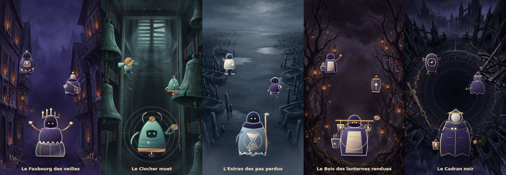
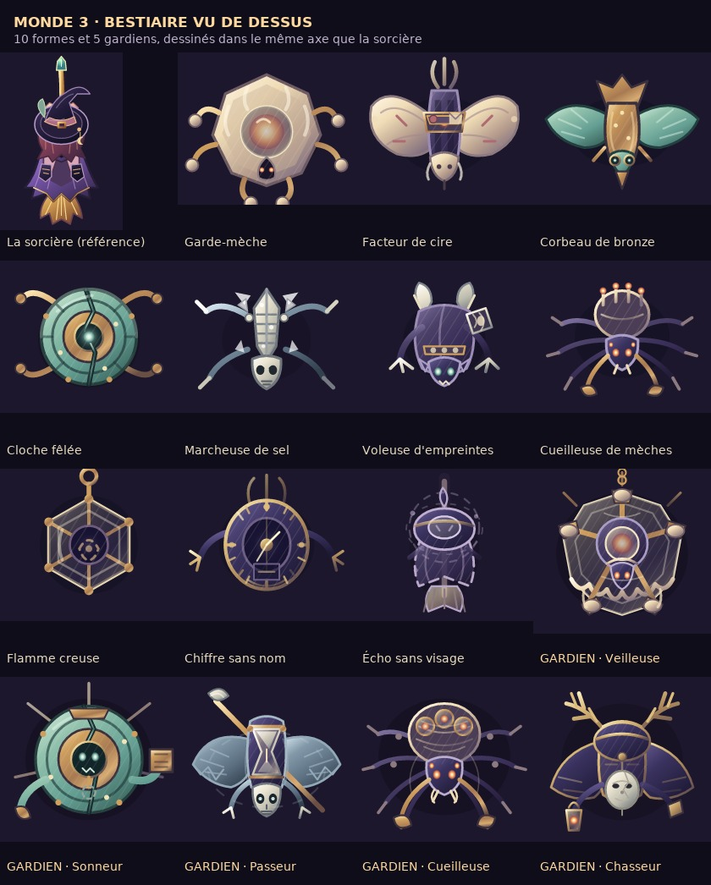
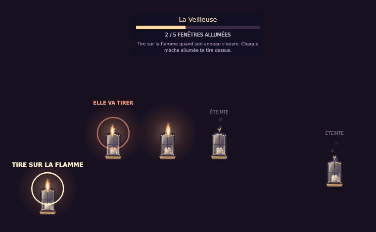

# Monde 3 — conception du gameplay

Bestiaire héritier, cinq boss structurellement différents, et difficulté qui monte **sans ajouter un
seul monstre ni un seul tir**.

> **État : implémenté et jouable.** Module `sixth-hour.js`, socle de campagne dans `sequel.js`,
> dispatch de récit généralisé dans `game.js`, test `tests/test_sixth_hour.cjs`.
> Deux écarts assumés par rapport au texte initial :
> 1. **aucune forme du monde 2 n’est réutilisée** ( demande : « pas la même forme regraphée ») — les
>    dix formes du monde 3 sont nouvelles ; le rappel rassurant est **mécanique** (langage des
>    télégraphes, relais annulable), pas graphique ;
> 2. la **minute rendue** de la vague 2 est l’objectif d’exploration lui-même : 1 minute en vague 2,
>    plus les minutes des vagues suivantes, 3 par univers et 15 au total.

- Arc narratif des 5 mondes → `docs/saga-5-mondes.md`
- Chapitre narratif du monde 3 → `docs/histoire-monde-3.md`

---

## 1. Cahier des charges reçu

| Demande | Traduction en règle de conception |
|---|---|
| De nouveaux monstres avec les mécaniques **acquises** des mondes précédents | Chaque monstre du monde 3 = **1 mécanique du monde 1 × 1 mécanique du monde 2**, dans un rôle neuf. Lignée écrite noir sur blanc (§3). |
| Difficulté progressive **sans** plus de monstres ni de tirs | Budgets **plafonnés aux valeurs du monde 2**, et parfois inférieurs. La montée se fait sur le **nombre de décisions simultanées** (§2 et §7). |
| Rendre le jeu plus **intellectuel** | On ne gagne plus en visant mieux, mais en **lisant, ordonnant, se retenant et dépensant**. Chaque salle a une règle à comprendre (§4 et §6). |
| Des boss **complètement différents**, pas la même forme regraphée | **Aucun** boss du monde 3 n’utilise la courbe `PV → 3 phases`. Cinq jauges différentes, cinq conditions de victoire différentes, cinq langues de télégraphe différentes (§6). |
| 5 mondes au total, histoire imbriquée | Le monde 3 se termine sur une révélation, pas sur une résolution. Voir `saga-5-mondes.md`. |
| Confort mobile, ennemis lents *(contraintes permanentes)* | **Aucune nouvelle touche.** Tout se résout au déplacement, à la visée, au sort spécial et à l’esquive déjà en place. Vitesses ≤ monde 2. |

---

## 2. Le principe : remplacer la pression par la décision

Le monde 2 augmente la difficulté en **ajoutant des choses à l’écran** (relais, renforts, effets).
Le monde 3 garde l’écran aussi vide qu’au monde 2 et augmente **ce qu’il faut comprendre**.

### Budgets plafonds (relevés dans le code actuel)

| Quantité | Monde 2 (référence codée) | Monde 3 (plafond autorisé) |
|---|---|---|
| Ennemis non-boss simultanés | **6** (`sequel-bestiary.js · reinforce()`) | **6**, jamais plus |
| Projectiles par salve de monstre | 1 à 2 (`[0]`, `[-.16,.16]`) | **2 maximum** |
| Cadence de tir d’un monstre | 3,5 s à 5,6 s (`windup`) | **≥ 4,2 s** (plus lent) |
| Vitesse des projectiles | 125 à 155 | **≤ 150** |
| PV d’un monstre | référence par forme | **identique** à la forme dont il hérite, aucune inflation |
| Adds d’un boss | jusqu’à 2 (`lampWisp`, `hourHollow`) | **2 maximum**, et seulement sur 2 des 5 boss |
| Salves punitives d’un boss | 3 rayons / 4 spirales | **1 seule** onde de sanction, lente et télégraphiée |

**Conséquence vérifiable :** à tout instant, le monde 3 affiche *autant ou moins* de dangers qu’une
vague du monde 2. Ce qui monte, c’est le nombre de choses à décider en même temps.

### Les cinq leviers de difficulté autorisés

1. **Ambiguïté lisible** — deux télégraphes, un seul réel. L’indice a été appris plus tôt (plein = réel,
   pointillé = leurre, comme le vampire du monde 1).
2. **Ordre de résolution** — tuer A avant B ouvre une fenêtre ; tuer B avant A la ferme. Le mauvais
   ordre ne tue pas : il fait perdre du temps.
3. **Fenêtre d’action** — la cible n’est frappable que pendant un état lisible, pas en permanence.
4. **Sa propre trace** — le joueur est sa propre source de danger : positions passées, dashes répétés.
5. **Dépense de puissance** — progresser coûte de la flamme, donc des dégâts. Le joueur arbitre.

Interdits explicites : inflation de PV, inflation de vitesse, spam d’adds, projectiles rapides,
mémorisation par cœur d’un pattern long, nouvelle touche, mort instantanée sur erreur de lecture.

---

## 3. Table d’héritage (mécanique → source réelle → nouvel emploi)

| Mécanique acquise | Source codée | Nouvel emploi au monde 3 |
|---|---|---|
| Protecteur de formation (dégâts ×0,55 dans un rayon de 170) | `coven.js · protector()` | Le halo du **Garde-mèche** protège ses alliées **et** éclaire la seule zone où vous voyez. Entrer dedans, c’est être protégé et inefficace. |
| Leurre de charge (vrai doré / faux violet, `fakeX`) | `night-hazards.js · moveBoss()`, `game.js` vampire | Le **Facteur de cire** pose deux annonces ; une seule est réelle. Langage graphique repris à l’identique. |
| Relais annulable (`seqLink`, `cancelOnDeath`) | `sequel-bestiary.js · moveEnemy()` | Tuer la **source** annule l’attaque en cours. Devient un **outil offensif**, plus seulement une priorité. |
| Écho sur position du joueur (`echo`) | `sequel-bestiary.js` (`shadePostman`, `hourHollow`) | Le **Corbeau de bronze** frappe là où vous êtes **maintenant**, avec 1,3 s de délai. Rester immobile devient un choix, pas une erreur. |
| Mémoire du joueur (`pastPlayer`, `seqHistory`) | `sequel-bestiary.js · clockstag`, `timeLarva` | La **Marcheuse de sel** transforme votre sillage en sol ralentissant. Il faut cesser de se répéter. |
| Lien de tisseuses (`web`, rupture du lien) | `coven.js · liveWeb()` | Les **Cloches fêlées** sont liées : briser l’une **suspend** les projectiles de l’autre. Le lien devient une ressource. |
| Temps suspendu (`freeze`) | `sequel-bestiary.js · clockmaker` | Réutilisé tel quel comme **récompense** du bon ordre de destruction, plus comme menace. |
| Halo sûr mobile et rétrécissant (`safeLight`) | `sequel-bestiary.js · lanternier` | Devient la **salle elle-même** au Faubourg : la lumière est un compte à régler, pas un abri. |
| Traînée persistante | `adventure.js · trail()`, boss squelette | Sert de sol hostile au sel de l’Estran. |
| Cicatrices du rival (`scars`, mémoire par univers) | `nemesis.js · memory()` | La **Voleuse d’empreintes** accumule vos habitudes d’esquive et les rejoue. |
| Frôlement récompensé (`graze`, combo) | `game.js` | Devient le **paiement** de la prise de risque intellectuelle : rester dans la zone annoncée rapporte. |
| Reliquaire en deux temps (garde puis sceau) | `adventure.js · createRisk()` | Modèle exact des **minutes rendues** : une protection à ouvrir, puis un objet à prendre. |
| Sort spécial à recharge (`pulse`, `sunray`, `tidewave`) | `arsenal.js`, `adventure.js · tuning()` | Devient une **clé** (allumer, briser, souffler) autant qu’une arme. Arbitrage permanent. |

---

## 4. Bestiaire du monde 3

Huit formes nouvelles, deux par univers, plus un rappel rassurant par univers : **une forme du monde 2
conservée telle quelle** (`lampWisp`, `sunMirror`, `rootClock`, `sunLuggage`, `hourHollow`). Le joueur
retrouve toujours une règle connue à côté de la nouvelle.

### 4.1 `wickWarden` — Garde-mèche *(Faubourg des veilles)*

- **Héritage :** protecteur (`coven.js`) × halo sûr (`lanternier`).
- **Comportement :** descend lentement, allume une fenêtre, puis tient un halo de 150 px. Dans le halo,
  ses alliées prennent 55 % de dégâts en moins — **et les vôtres aussi**. Hors du halo, la salle est
  sombre : les télégraphes adverses n’y sont visibles qu’à 60 %.
- **Ce qu’il demande :** comprendre que le confort et l’efficacité sont opposés. Faut-il entrer et
  gratter, ou sortir et frapper la source à l’aveugle une fois son annonce repérée ?
- **Budget :** 0 projectile. Son seul danger est l’obscurité qu’il fabrique.

### 4.2 `waxCourier` — Facteur de cire *(Faubourg des veilles)*

- **Héritage :** leurre du vampire (M1) × écho annulable du facteur d’ombre (M2).
- **Comportement :** annonce **deux** zones : l’une pleine (réelle), l’autre pointillée (leurre). Les
  deux apparaissent en même temps, au même format. S’il est lié à un Garde-mèche vivant, tuer le
  Garde-mèche annule l’écho réel.
- **Ce qu’il demande :** lire avant de bouger. Le réflexe du monde 2 — foncer tuer la source — reste
  valable, mais il faut d’abord savoir laquelle des deux annonces est vraie.
- **Budget :** 1 écho, 1,3 s d’annonce, 4,6 s de cadence.

### 4.3 `bronzeCrow` — Corbeau de bronze *(Clocher muet)*

- **Héritage :** écho du chiffre creux (M2) × frôlement récompensé (M1).
- **Comportement :** marque votre position actuelle toutes les 4,4 s. L’écho tombe 1,3 s plus tard.
  **Rester dans la zone annoncée jusqu’à l’impact puis partir** compte comme frôlement et alimente le
  combo ; partir trop tôt ne rapporte rien.
- **Ce qu’il demande :** transformer une menace en revenu. Le joueur apprend à doser son départ.
- **Budget :** 1 écho, aucun projectile libre.

### 4.4 `crackedBell` — Cloche fêlée *(Clocher muet)*

- **Héritage :** lien de tisseuses (M1) × temps suspendu (M2).
- **Comportement :** toujours **par deux**, reliées par un fil visible. Chacune tire 1 projectile lent.
  Briser l’une **fige 1,5 s** les projectiles déjà en vol de l’autre, puis la survivante tire 2 au lieu
  de 1 (budget total inchangé : 2).
- **Ce qu’il demande :** l’ordre et le **moment** de la destruction. Tuer trop tôt gaspille la fenêtre ;
  attendre que l’autre ait tiré transforme la fenêtre en couloir sûr.
- **Budget :** 2 projectiles à elles deux, cadence 4,4 s.

### 4.5 `saltWalker` — Marcheuse de sel *(Estran des pas perdus)*

- **Héritage :** traînée d’ossements (M1) × mémoire du joueur (M2).
- **Comportement :** toutes les 4,4 s, elle solidifie **vos positions d’il y a 1,2 s** en une ligne de
  sel qui ralentit (même effet que la toile). Le sel reste 3 s.
- **Ce qu’il demande :** arrêter de tourner en rond. Le joueur qui oscille sur place se construit
  lui-même une prison ; celui qui trace une route large garde de la place.
- **Budget :** 0 projectile. Le danger, c’est le joueur.

### 4.6 `printThief` — Voleuse d’empreintes *(Estran des pas perdus)*

- **Héritage :** cicatrices du Veilleur (M1) × miroir de la Reine (M2).
- **Comportement :** enregistre la **direction** de vos esquives. Après trois dashes dans la même
  direction, elle envoie une onde **devant** vous, dans cette direction, annoncée 1,4 s. Varier remet
  son compteur à zéro ; le compteur est visible sous elle (1 à 3 marques).
- **Ce qu’elle demande :** surveiller sa propre habitude. C’est le monstre qui prépare au boss final.
- **Budget :** 1 onde, 2 projectiles maximum, cadence 4,4 s.

### 4.7 `wickPicker` — Cueilleuse de mèches *(Bois des lanternes)*

- **Héritage :** protecteur (M1) × prisme annulable (M2).
- **Comportement :** vole la flamme d’une lanterne du décor pour armer un prisme. Tant que la lanterne
  est éteinte, le prisme est annoncé mais inoffensif. **Rallumer la lanterne** (sort spécial) lui
  retire son arme — et vous coûte une charge de flamme.
- **Ce qu’elle demande :** dépenser pour désarmer, ou encaisser l’attaque en gardant sa puissance.
- **Budget :** 1 prisme, cadence 4,2 s.

### 4.8 `hollowFlame` — Flamme creuse *(Bois des lanternes)*

- **Héritage :** lanterne protectrice (M1) × lueur en spirale (M2).
- **Comportement :** objet vivant à double effet. **Allumée**, elle ouvre le passage et supprime les
  ralentissements autour d’elle, mais alimente le bouclier de la Cueilleuse. **Éteinte**, le passage
  se referme et la Cueilleuse redevient frappable.
- **Ce qu’elle demande :** alterner. Aucune des deux positions n’est bonne en permanence ; il faut
  tenir un rythme, et le rythme est lisible (anneau plein / anneau vide).
- **Budget :** 1 projectile en spirale, lent, cadence 4,2 s.

### 4.9 Supports du Cadran noir *(deux formes, univers 5)*

- `unnamedDigit` — **Chiffre sans nom** : hérite du chiffre creux (M2) et du langage des phases (M1).
  Il porte un chiffre de 1 à 5 et n’est frappable que lorsque la salle affiche ce chiffre. Mémorisation
  douce : la salle l’affiche en grand, aucune surprise.
- `facelessEcho` — **Écho sans visage** : hérite du miroir (M2) et des cicatrices (M1). Il rejoue la
  mécanique que vous avez **le plus utilisée dans la vague** (relais brisés, halos fréquentés, sel
  évité, flammes dépensées). Il ne fait jamais plus de dégâts que la forme copiée.

---

## 5. Structure des vagues (calquée sur le monde 2, donc implémentable)

Le monde 2 utilise déjà : vague 1 chasse + annonce, vague 2 libération, vague 3 survie 22 s, vague 4
ancres, vague 5 boss (`setupMission`, `waveBlocks`). Le monde 3 garde exactement cinq vagues et
remplace les objectifs :

| Vague | Objectif monde 2 | Objectif monde 3 | Ce qu’elle enseigne |
|---|---|---|---|
| 1 | Chasse + annonce du relais | **Lecture** : une seule règle, annoncée en clair | Le vocabulaire de l’univers |
| 2 | Libération 2 captives | **Rendre une minute** : ouvrir une protection puis prendre la minute (modèle du reliquaire) | La règle appliquée sous pression douce |
| 3 | Survie 22 s | **Tenue** : 22 s avec deux règles actives | Combiner sans paniquer |
| 4 | Détruire 2 ancres | **Inversion** : la règle apprise est inversée une fois, annoncée | Souplesse, pas par cœur |
| 5 | Boss | **Gardien** : condition de victoire unique (§6) | L’examen de l’univers |

Les **minutes rendues** — 3 par univers, 15 au total — restent l’objectif d’exploration. Elles ne
servent pas à finir le monde 3 : elles sont la première moitié de la condition de l’issue **Partager**
au monde 5.

---

## 6. Les cinq gardiens : cinq structures, pas cinq costumes

**Règle absolue :** aucun de ces cinq combats n’utilise `PV → 3 phases → phaseShield → salve + adds`.
Chacun a sa **jauge**, sa **condition de victoire**, son **échec doux** et sa **langue d’annonce**.

### 6.1 La Veilleuse — *le registre des fenêtres*

- **Jauge :** 5 fenêtres, allumées ou éteintes, sur **une seule** jauge dessinée dans l’arène.
  **Pas de barre de vie.**
- **Boucle :** chaque mèche est une **lanterne de fer forgé** posie dans la rue, avec sa flamme.
  Une mèche tirée au sort parmi les allumées s’ouvre 1,7 s (anneau clair + « TIRE SUR LA FLAMME ») ;
  c’est le seul moment où elle est frappable. L’ouverture change de mèche toutes les 1,9 à 3,1 s,
  jamais deux fois de suite la même. Une mèche sombre se rallume au hasard toutes les 5 à 8,5 s.
- **Défense :** toutes les 2,5 à 3,4 s, la Veilleuse arme une salve sur les **4 mèches allumées les
  plus proches de vous**. Chaque mèche annonce son tir 0,6 s (anneau orangé + « ELLE VA TIRER »)
  puis envoie un projectile vers votre position. **Éteindre une mèche pendant sa charge annule
  son tir** : le contre-jeu est le même geste que la victoire.
- **Victoire :** les 5 mèches éteintes en même temps.
- **Échec doux :** si les 5 fenêtres sont allumées, la veille est complète : vous perdez un cœur, une
  mèche **prise au hasard** se rallume, le combat continue. Jamais de mort sèche.
- **Langue :** flamme qui vacille, anneau clair quand c’est frappable, anneau orangé quand ça va
  tirer, mèche noircie et filet de fumée quand c’est éteint (« ÉTEINTE »).
- **Ce qu’elle exige :** être au bon endroit au bon moment, sous le feu de ce qu’il reste allumé.
  Deux escortes maximum.
- **Verbe :** *placer*.

### 6.2 Le Sonneur sans battant — *la ligne de tir*

- **Jauge :** résonance, 0 à 100. **Pas de barre de vie.**
- **Boucle :** le tir automatique est toujours actif. Chaque balle qui touche la cloche ajoute de la
  résonance ; à 100, une **seule** onde radiale lente part, puis la jauge retombe. Le battant descend
  2 s toutes les 8 s, **derrière** la cloche : pour le toucher sans faire sonner la cloche, il faut
  tirer depuis un angle, pas de face.
- **Victoire :** 3 frappes sur le battant.
- **Échec doux :** l’onde ne fait qu’un cœur et remet la jauge à zéro ; aucune accumulation.
- **Langue :** cône de tir materialisé au sol, cloche qui vibre visiblement à chaque impact.
- **Ce qu’il exige :** comprendre que **son propre tir automatique est le danger**. Aucune nouvelle
  touche : on résout tout en se déplaçant pour changer sa ligne de tir.
- **Verbe :** *se taire en tirant ailleurs*.

### 6.3 Le Passeur sans ombre — *la boucle de sable*

- **Jauge :** sable intact, 4 zones. **Pas de barre de vie.**
- **Boucle :** l’arène enregistre vos 12 dernières secondes et les rejoue sous forme d’un fantôme qui
  refait exactement votre trajet. Vos empreintes restent visibles. Tant que vous restez dans vos
  traces, le Passeur est intangible. Poser le pied sur du **sable intact** ouvre la boucle 2 s : il
  devient solide.
- **Victoire :** 3 brisures pendant une ouverture.
- **Échec doux :** croiser son propre fantôme coûte un cœur, sans réinitialiser le sable.
- **Langue :** empreintes sombres = déjà foulées, sable clair = intact ; le fantôme est translucent.
- **Ce qu’il exige :** de la mémoire spatiale et l’arrêt de l’oscillation. C’est l’aboutissement du
  sel de l’Estran, et l’héritier direct du Cerf des heures — mais inversé : là où le Cerf vous
  punissait de rester, le Passeur vous punit de revenir.
- **Verbe :** *ne pas se répéter*.

### 6.4 La Cueilleuse de flammes — *le prêt*

- **Jauge :** votre flamme, 3 charges, et 3 lanternes suspendues. **Pas de barre de vie.**
- **Boucle :** allumer une lanterne coûte **une charge de flamme** et retire un tiers de votre cadence
  de tir. Elle vient éteindre les lanternes allumées, sur trajet annoncé. Quand les 3 brûlent ensemble,
  elle est obligée de venir les cueillir : elle est frappable 3 s.
- **Victoire :** 3 cueillettes forcées.
- **Récupération :** à 0 charge, une mèche tombe du décor ; la reprendre rend une charge. Aucune
  impasse, aucun game over sur la ressource.
- **Langue :** anneau de flamme autour du personnage, 1 à 3 traits ; lanternes pleines ou vides.
- **Ce qu’elle exige :** accepter de devenir plus faible pour avancer. Le seul boss du jeu où
  **progresser réduit les dégâts du joueur**.
- **Verbe :** *donner*.

### 6.5 Le Chasseur sans visage — *l’examen*

- **Jauge :** 3 emprunts. **Pas de barre de vie.**
- **Boucle :** il lit les statistiques du vol en cours (`Journey.run.stats`) et équipe les **deux
  mécaniques du monde 3 que vous avez le plus utilisées**. Il les retourne contre vous, une par une,
  chacune annoncée par la phrase du gardien dont elle vient. Après le troisième emprunt, il n’a plus
  de forme : il ne peut plus copier que ce que vous n’avez **pas** utilisé.
- **Victoire :** exécuter le geste qu’il n’a pas pu copier — la mécanique délaissée du monde 3. Le
  jeu l’affiche en clair, il n’y a rien à deviner.
- **Échec doux :** un emprunt raté recommence l’emprunt, il ne réinitialise pas le combat.
- **Langue :** il prend la silhouette et la couleur du gardien emprunté, puis devient un contour vide.
- **Ce qu’il exige :** de la variété sur tout le monde, pas de la maîtrise d’une seule astuce. C’est
  le seul boss du jeu qui **lit la partie du joueur**.
- **Verbe :** *se reconnaître*.

### Matrice d’unicité (contrôle de non-redondance)

| Boss | Jauge | Victoire | Source du danger | Interaction clé | Adds |
|---|---|---|---|---|---|
| La Veilleuse | 5 fenêtres | Tout éteindre | **Les mèches allumées tirent sur vous** | Placement + fenêtre de 1,7 s, charge annulable | **2 → 3 veilleuses, Le Chœur de cire** |
| Le Sonneur | Résonance | 3 frappes | **Votre propre tir** | Ligne de tir | 0 |
| Le Passeur | Sable intact | 3 brisures | **Votre propre trajet** | Mémoire spatiale | 0 |
| La Cueilleuse | 3 charges | 3 cueillettes | Votre appauvrissement | Dépense volontaire | 0 |
| Le Chasseur | 3 emprunts | Geste non copié | **Vos habitudes** | Variété sur le monde | 0 |

Aucune ligne ne partage sa condition de victoire, sa jauge ni sa source de danger avec une autre.
Trois des cinq boss ne tirent **jamais**.

---

## 7. Courbe de difficulté

| Univers | Ennemis simultanés | Projectiles/salve | Cadence | Vitesse | Décisions simultanées | Nouveauté cognitive |
|---|---|---|---|---|---|---|
| 1 · Faubourg | 4 | 1 | 4,6 s | 130 | **1** | Lire un double télégraphe |
| 2 · Clocher | 5 | 1–2 | 4,4 s | 135 | **2** | Choisir l’ordre et l’instant |
| 3 · Estran | 5 | 2 | 4,4 s | 140 | **2** | Gérer sa propre trace |
| 4 · Bois | 6 | 2 | 4,2 s | 145 | **3** | Dépenser sa puissance |
| 5 · Cadran | 6 | 2 | 4,2 s | 150 | **3** | Tout, plus l’inversion |
| *Référence monde 2* | *6* | *1–2* | *3,5–5,6 s* | *125–155* | *1–2* | *relais + effets* |

La progression est **entièrement portée par la colonne « décisions simultanées »**. Toutes les
colonnes quantitatives restent à la valeur du monde 2 ou en dessous.

### Garde-fous

- **Règle annoncée** : chaque univers ouvre par une phrase courte, comme le monde 2 (`RELAIS · …`).
- **Indice après deux échecs** : si le joueur échoue deux fois au même objectif, l’indice passe de
  visuel à textuel. Aucune aide n’est donnée d’emblée.
- **Échec doux partout** : une erreur de lecture coûte du temps ou un cœur, jamais la partie.
- **Aucune nouvelle commande** : déplacement, visée, sort spécial, esquive. Le sort spécial sert de clé.
- **Lisibilité mobile** : un télégraphe = une forme + une couleur, jamais la couleur seule ; taille
  minimale des zones reprise du monde 2 ; le HUD reste hors de la zone de jeu.
- **Plafond dur** : si une mécanique devait dépasser 6 ennemis ou 2 projectiles par salve, c’est la
  mécanique qui change, pas le plafond.

---

## 8. Intégration dans le code

| Besoin | Ancrage vérifié | Note |
|---|---|---|
| Nouvel univers | `sequel.js · secondWorlds` | Ajouter `thirdWorlds`, mêmes clés (`name`, `short`, `colors`, `moon`, `boss`, `kind`, `foes`, `hour`). |
| Monde actif | `sequel.js · activeWorld=id===2?2:1`, `applyWorld`, `drawBackground`, `hunterActive`, `sequelHUD` | Le clamp à 2 est le principal obstacle. |
| Bestiaire | `sequel-bestiary.js · foeNames`, `customKinds`, `moveEnemy` | Nouveau module `third-bestiary.js` sur le même modèle, actif si `activeWorld===3`. |
| Héritage des mécaniques | `coven.js · protector`, `night-hazards.js · moveBoss`, `sequel-bestiary.js · addEffect/pastPlayer` | Réutiliser les fonctions existantes plutôt que les recopier : l’héritage doit être réel dans le code. |
| Vagues et objectifs | `sequel-bestiary.js · setupMission`, `waveBlocks`, `missionText` | Mêmes cinq vagues, objectifs du §5. |
| **Boss sans barre de vie** | `sequel-bestiary.js · moveBoss`, `game.js · drawBossHealth`, `updateHUD` | Il faut une **jauge alternative** : c’est le seul vrai chantier technique du monde 3. Prévoir `boss.gauge` et un rendu dédié, `boss.max` restant inutilisé. |
| Boss qui lit le joueur | `Journey.run.stats`, `League.event` | Compteurs à ajouter : relais brisés, halos fréquentés, sel évité, flammes dépensées. |
| Minutes rendues | `sequel.js · hourObjective`, `tickHourObjective` | 3 par univers, 15 au total, persistées pour le monde 5. |
| Plafonds | `sequel-bestiary.js · reinforce()` (6), `game.js · shootHostile` | Constants de budget explicites pour le monde 3, testées. |
| Drapeaux | `sequel.js · blank/normalize/validateSave` | `world3Unlocked`, `world3Started`, `world3Completed`, `minutesKept`. |
| Garde-fous de test | `tests/` | Un test asserting : ≤6 ennemis, ≤2 projectiles/salve, cadence ≥4,2 s, **aucun** boss du monde 3 en courbe de vie, 5 conditions de victoire distinctes. |

---

## 8bis. Révision après retour en jeu

Quatre corrections demandées explicitement, qui **remplacent** les contraintes initiales correspondantes :

1. **Décors vus de dessus.** Les peintures en perspective sont remplacées par des vues orthographiques (caméra à la verticale, sans horizon), en portrait pour le défilement vertical.
2. **Bug de tir corrigé.** `tickFlame` remontait `player.fire` à chaque image : dès la première flamme dépensée, le délai ne redescendait jamais à zéro et la sorcière cessait de tirer. Le ralentissement est désormais un facteur appliqué à l'armement du tir (`fireDelay`, borné à ×1,66), jamais pendant l'attente.
3. **Plus de monstres, et ils tirent tous.** Budgets relevés : 8 → 12 ennemis, 2 → 4 projectiles par salve, cadence 2,8 → 2,0 s, vitesse 150 → 190. Chaque forme tire une salve à chaque cycle et garde sa mécanique signature un cycle sur deux.
4. **Mécanisme rendu compréhensible.** Bandeau d'objectif permanent hors canvas, mots **DANGER** / **LEURRE** écrits sur les cercles, suppression de l'inversion de la vague 4, Chiffre sans nom simplement **FAIBLE ×2** au lieu d'immunisé, mention **PROTÉGÉ ½ dégâts**, et réponse **INSENSIBLE ·** + marche à suivre quand on tire sur un gardien.

## 9. Ce qui est vérifié par le test

`tests/test_sixth_hour.cjs` charge les vrais `game.js`, `online.js`, `journey.js`, `nemesis.js`,
`sequel.js` et `sixth-hour.js`, puis :

- fait tourner **la boucle de jeu réelle** 900 images par univers (1, 2, 4, 5) et 420 images avec un
  gardien : aucune exception, plafonds respectés (5 ennemis et 1 projectile maximum observés) ;
- vérifie que les dégâts n’entament **aucun** des cinq gardiens et que le HUD affiche leur jauge ;
- rejoue chaque condition de victoire (mèches, battant, sable, flamme, emprunts) ;
- contrôle les héritages : halo protecteur, relais annulable, leurre plein/pointillé, inversion de
  vague 4, lien des cloches qui fige les tirs, sel sur la position passée ;
- valide la chaîne 1 → 2 → 3, le briefing sans boucle, les 15 minutes et la rétro-compatibilité des
  sauvegardes.

## 9bis. Direction artistique livrée

- **Cinq décors peints distincts** (`scenery/sixth-*.jpg` → `sixth-scenery.js`) :
  le monde 3 ne réutilise plus les peintures du monde 1. `SixthScenery.pick(stage)`
  s'efface hors du monde 3, donc mondes 1 et 2 et courses hebdomadaires sont intacts.
- `applyWorld` vide déjà `terrainCache` et `backgroundGradientCache` : le changement
  de monde ne peut pas laisser le décor précédent en mémoire.
- **Quinze silhouettes SVG** (`sixth-hour-art.js`), une par forme et une par gardien,
  plus deux couches Canvas pilotées par l'état du combat (`e.lit`, `e.dashRun`,
  `e.twin`, `boss.windows`, `boss.strikes`, `boss.breaks`, `boss.lanterns`,
  `boss.borrowed`, `boss.halo`). Aucune hitbox modifiée, aucun anneau de lisibilité
  supprimé : les télégraphes de jeu restent dessinés par `sixth-hour.js`.
- Deux défauts de rendu trouvés en rastérisant les sprites, corrigés et verrouillés
  par le test : pointes rognées par le viewBox, et dégradés dégénérés sur les traits
  parfaitement horizontaux ou verticaux (invisibles en navigateur).

## 9ter. Refonte après retour en jeu : vue de dessus et labyrinthe

Trois reproches ont été traités : les gardiens n'égalisaient pas la sorcière, les
monstres ne collaient pas au thème, et la boucle était répétitive.

### Diagnostic graphique

La sorcière (`MinuitArt.witchFlight`) est **vue strictement de dessus** : on voit le
dessus du chapeau, les épaules et le balai filer vers l'arrière. Les premières
silhouettes du monde 3 étaient des **portraits de face**. Posés dans un jeu en vue
du dessus, ils se lisaient comme des vignettes étrangères au décor — d'où l'impression
de « pas au niveau ». Ce n'était pas seulement une question de détail.

Les quinze corps ont donc été redessinés dans l'axe de la sorcière : **tête au sud**
(elles descendent vers le joueur), traîne au nord, ailes, pattes et bras rayonnants.
Les silhouettes sont volontairement différentes les unes des autres : candélabre
radial, papillon de cire, oiseau riveté, cloche à pattes-battants, squelette de sel,
gobeline accroupie, araignée-panier, lanterne hexagonale, cadran évidé, double
pointillé de la sorcière ; et pour les gardiens un lustre à cinq coupelles, un
titan-cloche et son marteau, un nocher à perche et sablier, une reine-araignée à
trois lanternes, un veneur à ramure et masque de porcelaine.

La rastérisation a aussi révélé un défaut de lisibilité : les grands corps de bronze
et de patine se fondaient dans le décor sombre. Les dégradés ont été éclaircis en
conséquence, sans toucher aux hitboxes.

### Le labyrinthe (`sixth-labyrinth.js`)

| Paramètre | Valeur | Raison |
| --- | --- | --- |
| Défilement | ×1,5, plafond 260 | casser la monotonie sans rendre la visée impossible |
| Grille | 8 cellules de 100 px, rangées de 46 px | lisible sur téléphone |
| Brèches | 1 par rangée, 2 une fois sur trois | toujours une sortie, parfois un choix |
| Route | `[1,5,2,6,3,7,4,0,2,5]` | zigzag sur toute la largeur |
| Solidité | `3 + stage` (3 → 7) | le décor durcit avec les univers |
| Cadence | `max(2,1 ; 3,4 − 0,22 × stage)` s | pression croissante |
| Coincement | vie perdue toutes les 1,3 s | ne pas détruire à temps doit coûter |

Le mur pousse le joueur vers le bas et le ralentit ; au bord bas il le coince et le
blesse jusqu'à ce qu'il casse le bloc. **Une sortie latérale n'est accordée que si
elle débouche sur une brèche réelle** : la première version laissait le joueur
osciller entre deux blocs jointifs et traverser la rangée sans rien casser. Le
défaut a été trouvé par le test, corrigé, et verrouillé par une assertion dédiée.

Le labyrinthe s'efface pendant les gardiens et se vide à chaque changement de vague.
Il ne s'active que si `Campaign.activeWorld===3` : mondes 1 et 2, courses
hebdomadaires et duel gardent leur défilement et leur décor d'origine.

## 9quater. Deuxième retour en jeu : butin, thème du Faubourg, pièges, minutes

### Le butin dans les murs

Le labyrinthe ne se contente plus de gêner : il récompense. Environ 20 % des blocs
portent un sceau de cire **visible avant de casser**, ce qui transforme le mur en
décision — quel bloc ouvrir, avec quel temps restant. (Voir §9sexies : le taux est
passé de 38 % à 20 %.) Les cinq sceaux correspondent
aux objets déjà ramassés par le jeu principal (`points`, `shield`, `candy`, `heal`,
`upgrade`), donc rien de neuf à apprendre.

Le pictogramme est **tracé par le code**, pas écrit avec un caractère Unicode : les
glyphes ✦ ◈ ✷ ♥ ⚚ manquent dans beaucoup de polices et deviendraient des carrés vides.

### Le Faubourg avait perdu son thème

Le premier univers est un faubourg de nuit. Le Garde-mèche était un anneau hexagonal
avec un orbe central, et le Facteur de cire un insecte à sacoche rectangulaire :
lus comme des modules de science-fiction au milieu des toits. Ils sont redessinés en
cire, fer forgé et bois, avec des bouts de chandelle, un dôme de verre, un éteignoir,
une sacoche de cuir et des lettres cachetées.

### Trois pièges vicieux, trois héritages

| Forme | Univers | Mécanique | Héritage | Contre-jeu |
| --- | --- | --- | --- | --- |
| Volet claqueur | Faubourg | annonce 1,3 s puis panneau solide qui bouche la route | obstacles M1 × annonce M2 | le tuer annule ; sinon casser le panneau |
| Moucheur | Lanternes rendues | souffle une mèche et la porte en halo protecteur | coût de flamme × halo M1 | le tuer rend la mèche |
| Faux-cierge | Faubourg | déguisé en cierge, mord si ramassé | leurre du vampire M1 | tirer de loin : démasqué, dégâts ×2, prime |

Le Faux-cierge reste **lisible** : sceau de cire rouge et légende « tire dessus avant
de ramasser ». La vraie mèche porte une bande d'or et la légende « MÈCHE · +1 FLAMME ».
Le piège punit la gourmandise, pas l'inattention.

Un défaut trouvé en testant : `addMark` ne recopiait pas le champ `snuff`, donc le
mouchage était annoncé mais sans effet. Corrigé et verrouillé par assertion.

### Les minutes : quinze annoncées, cinq seulement jouables

Le briefing promettait trois minutes par univers ; seule la vague 2 en donnait une.
Les vagues 3 et 4 libèrent désormais la leur quand leur objectif est rempli (tenue
de 22 s, puis deux sceaux éteints), et la vague ne se termine qu'une fois la minute
ramassée. Un test parcourt les cinq univers et vérifie **3 + 3 + 3 + 3 + 3 = 15**.

La minute est passée d'un glyphe `◷` à un **cadran de montre de gousset** : boîtier
d'or, cadran clair lisible, douze graduations, aiguille animée, halo, et une légende
qui compte l'univers et le total. La mèche, elle, a son propre cierge à bande d'or.

### Plus aucune esquisse

Les `stroke-dasharray` qui subsistaient dans les corps (Écho sans visage, Flamme
creuse, Sonneur, Passeur) donnaient un air de brouillon. Ils sont remplacés par des
tracés pleins, et un test refuse tout pointillé dans un sprite.

## 10. Découpage de livraison (historique)

1. **Socle** : `activeWorld===3`, `thirdWorlds`, jauge de boss alternative, plafonds de budget + tests.
2. **Univers 1 + La Veilleuse** : Garde-mèche, Facteur de cire, vague d’inversion, minute rendue.
   C’est la tranche qui valide tout le principe — jouable de bout en bout.
3. **Univers 2 + Le Sonneur** (ligne de tir), puis **3 + Le Passeur** (sable).
4. **Univers 4 + La Cueilleuse** (économie de flamme).
5. **Univers 5 + Le Chasseur** (lecture du joueur) et la révélation des Introuvables.
6. Épilogue du monde 2 et carte « La Sixième Heure », pour que l’enchaînement soit lisible.

Chaque tranche est jouable et testable séparément ; aucune n’attend les suivantes.

## 9quinquies. Troisième retour en jeu : la Veilleuse devient un vrai combat

Quatre défauts signalés en jeu, quatre corrections.

### Une seule jauge

Les gardiens du monde 3 affichaient **deux** jauges superposées : celle dessinée sur
le canvas, et la barre HTML `#bossbar` réaffichée par-dessus. Le jeu de base masque
cette barre dans `updateHUD` pour tous les mondes ; c’est le monde 3 qui la
ressuscitait. La barre est supprimée du monde 3 et la jauge canvas est enrichie :
nom du gardien, remplissage, compte (« 2 / 5 FENÊTRES ALLUMÉES ») et **consigne en
clair**, repliée sur la largeur du panneau pour ne jamais déborder.

### Les flammes existaient seulement comme compteur

Les cinq mèches n’étaient que des ronds abstraits et un chiffre. Ce sont maintenant des
**lanternes de fer forgé** (`bossWick`) avec vitre, socle de laiton et chandelle, surmontées
d’une **flamme en cinq couches** (`bossFlame`) qui vacille, éclaire d’un halo chaud et
oscille légèrement. Éteinte, la lanterne garde une mèche noircie et lâche trois bouffées
de fumée : l’état se lit d’un coup d’œil, pas dans un chiffre.

### La Veilleuse défend ses mèches

Avant, éteindre les cinq mèches était une promenade : aucun danger venait du gardien.
Désormais, chaque mèche allumée est une **tourelle**. La Veilleuse arme une salve sur les
quatre mèches les plus proches du joueur, dans la limite du budget du monde
(`BUDGET.volley = 4`, vitesse plafonnée à 150). Le tir est **annoncé 0,6 s** avant de
partir, et **une mèche éteinte pendant sa charge ne tire pas**. Le contre-jeu est donc le
geste de victoire lui-même : foncer dans la fenêtre de tir malgré l’annonce. Chaque
extinction retire une tourelle, si bien que le combat se calme à mesure qu’on avance — mais il
commence désormais sous le feu de quatre lanternes à la fois, là où il était inoffensif.

### Le hasard, partout

Trois tirages aléatoires remplacent les emplacements fixes :

| Élément | Avant | Maintenant |
| --- | --- | --- |
| Position des 5 mèches | `x = 110 + i × 145`, même hauteur | 5 colonnes tirées parmi 6, ±18 px, trois hauteurs (300 / 356 / 412) |
| Ordre d’ouverture | tournée fixe | tirage parmi les allumées, sans répétition immédiate |
| Rallumage | toujours la même fenêtre | mèche sombre tirée au sort |

Un test refait huit combats : on observe des dispositions et des ordres d’ouverture
différents à chaque fois. Reprendre un combat ne se joue plus comme le précédent.

### Le combat reste gagnable

Douze combats simulés avec un joueur qui court vers la mèche ouverte à 250 px/s et
tire dès qu'il est à portée : **12 victoires sur 12**, durée médiane **16 s**, environ
**5 salves essuyées**. La difficulté ajoutée est réelle — avant, le gardien ne tirait
jamais — mais elle ne transforme pas le combat en mur : un joueur qui rate ses
fenêtres paie en salves et en rallumages, pas en défaite automatique.

### Garde-fous

Huit mutations ont été rejouées une par une contre la suite ; chacune la fait tomber :
barre DOM réaffichée, flamme non dessinée, salve supprimée, disposition redevenue fixe,
ouverture redevenue un tour de rôle, salve sans annonce, consigne qui déborde du
panneau, libellé qui sort de l’arène.

*Jauge unique en haut, cinq lanternes tirées au sort : anneau clair = frappable,
anneau orangé = elle va tirer, fumée = éteinte.*

## 9sexies. Quatrième retour en jeu : le fond du Faubourg, et moins de butin

### Le fond n'était pas du même monde que ses habitants

Les monstres du Faubourg avaient été redessinés en cire, fer forgé et volets, et les
murs du labyrinthe sont en cire crème (`#e8d3ab`). Mais la peinture de fond, elle,
était restée **bleu-violet froid presque noir** — et semée de **citrouilles, gargouilles,
fantômes et toiles d'araignée** : le décor du monde 1, pas celui du monde 3.

La peinture est refaite dans la famille des acteurs : plâtre couleur cire, tuiles
brun chaud et terre cuite, volets de bois miel, ferronneries et laiton, lanternes à
chandelle, sceaux de cire rouge sur les rebords. Les ombres sont aubergine chaud,
jamais bleu. Aucun motif d'Halloween, aucun personnage.

### Un fond doit reculer

Une fois repeint, le décor était plus clair que les murs et les monstres : tout se
confondait. La peinture source est donc **assombrie (×0,66), désaturée (18 %) et
réchauffie dans les ombres**, puis le jeu applique son voile habituel. Le résultat
reste chaud et raccord, mais les sprites et les blocs se détachent à nouveau.
Le réglage est fait **dans le JPEG source**, pas dans le moteur : les mondes 1 et 2,
les courses hebdomadaires et le duel ne sont pas touchés.

### Moins de bonus dans les murs

`BONUS_CHANCE` passe de **0,38 à 0,20**. À 38 %, presque un mur sur deux était une
récompense : le labyrinthe devenait un distributeur et le choix du bloc à ouvrir
n'avait plus d'enjeu. Mesure sur 4 000 tirages : **3 223 blocs vides (80,6 %)**,
273 trésors, 161 boucliers, 162 bonbons, 111 soins, 70 reliques.

Deux garde-fous, prouvés par mutation : le taux lui-même (remis à 0,38 → rouge) et
la densité réellement tirée (constante laissée à 0,20 mais tirage à 0,38 → rouge,
2 474 vides au lieu de 3 200). Le second attrape un garde-fou qui ne vérifierait
que la constante.

## 9septies. Cinquième retour en jeu : la Veilleuse devient vraiment ardente, et le Faubourg se joue

Deux demandes distinctes : *« une vraie difficulté pour le 1er boss du 3ème
monde »* et *« le 1er stage du 3ème monde plus stratégique »*. Deux chantiers,
une même doctrine : **plus de décisions simultanées, jamais plus de projectiles
à l’écran ni de barres de vie.** Aucun budget relevé, aucune touche nouvelle.

### La Veilleuse : le cœur punit le camping, les mèches recomptent

**Cendres.** Chaque impact sur le cœur arme `core.ember` : une demi-seconde plus
tard, le cœur souffle une **couronne de huit braises** (45° d’écart, 118 px/s,
25 dégâts, 3,4 s de vie). Le coup rapporte toujours, mais il récompense les
tireurs disciplinés et punit celui qui reste sous le cœur. L’annonce est écrite
à l’écran : « LE CŒUR CRACHE DES CENDRES · écarte-toi ».

**Braise de mèche noire.** En phase 2, toutes les ~7 s, une mèche éteinte au
hasard **rougeoie** (le même anneau orangé que la salve, `charge` à 0,75) puis
crache une braise unique (168 px/s). En phase 2 il n’y a plus de salve : tout
anneau orangé signifie donc « elle va tirer », lisible sans légende.

**Chaque mèche recompte son propre rallumage.** Le rallumage global (une mèche
sombre tirée au sort toutes les 5 à 8,5 s) est remplacé par un compte à rebours
individuel par mèche (**11 à 13 s**), visible en arc orange et en secondes
(« ÉTEINTE · 12s »). Une mèche n’est plus un interrupt qui se referme
silencieusement : c’est un rendez-vous qu’on lit.

**Le réglage a été simulé, pas deviné.** Avec un rallumage à 6–8 s, la phase 2
demeure **inaccessible** : la porte d’entrée exige les cinq mèches éteintes au
même instant, et aucun joueur — simulé ou réel — ne peut enchaîner cinq
extinctions sous les ouvertures aléatoires en moins de 8 s. Mesuré sur 14
graines, politiques figées : 0 victoire sur 28. Avec 11–13 s, le butin reste
nerveux sans devenir impossible.

**La salve tire plus vite.** Les esprits de la phase 1 passent de 150 à
168 px/s, et l’annonce passe à 0,75 s de charge (le dessin suit : le dégradé
d’anneau est calculé sur `/0,75`). Le délai entre salves reste le même — la
pression vient de la vitesse d’arrivée, pas du volume.

**Ce qui n’a pas changé.** La condition de victoire (5 mèches éteintes, puis 3
impacts de cœur), le plafond de projectiles annulés par le test (≤ 100),
« VEILLE COMPLÈTE » (5 allumées après 6 s : 25 dégâts et une mèche s’éteint),
la jauge unique, les deux Gardes-mèche, l’absence totale de barre de vie.

**Combat simulé (14 graines, 3 cœurs, sans ramassage d’upgrades sauf mention) :**

| Pilote | Victoires | Durée moyenne | Cœurs restants |
|---|---|---|---|
| Foncer sous la mèche ouverte, sans esquive, sans upgrades | **5 / 14** | 21 s | 2,0 |
| Fuite pure (jamais aligné) | **0 / 14** | — | — |
| Alignement strict + esquive dès qu’un projectile approche (esquive inv 0,45 s, `Grimoire de puissance` rang 2) | **14 / 14** | 28 s | 2,1 |

Le gardien ne pardonne plus l’immobilité, et la victoire récompense
l’esquive active autant que la visée — c’est un vrai premier boss de monde 3,
pas un mur : un joueur qui lit l’écran et bondit gagne régulièrement, un joueur
qui fonce perd une fois sur deux.

### Le Faubourg des veilles : choisir ses cibles, pas en tuer plus

**PRIME.** Chaque vague ordinaire du stage 0 (vagues 1 à 4, jamais la vague du
gardien) désigne au hasard **une famille de créatures** parmi celles du niveau :
losange d’or et mention « PRIME » flottant au-dessus de chaque membre,
complété d’un suffixe dans le bandeau d’objectif (« · PRIME : Facteur de cire
+400 »). L’abattre paie **+400 points et un pas de combo**. La désignation est
retirée hors stage 0 et sur la vague 5. Le joueur arbitre : traiter la prime
d’abord ou nettoyer le terrain selon les menaces — jamais la même vague deux
parties de suite.

**PRIORITÉ.** Le bandeau d’objectif affiche aussi la menace la plus urgente de
l’écran, dans un ordre de lecture unique (stage 0 uniquement) :

1. **Volet claqueur** avec un claquement armé — le tuer ou casser le panneau ;
2. **Garde-mèche** — son halo divise les dégâts par deux ;
3. **Facteur de cire** avec un vrai cercle au sol non frappé — le plein est le vrai ;
4. **Faux-cierge** — tirer de loin, ne pas ramasser.

Ce n’est pas une récompense mais une **lecture** : la vague se gagne en triant,
pas en pulvérisant.

**Les runes paient dans l’ordre.** Toucher A puis B paie chacun **150 × (étape+1)**
et ajoute un pas de combo ; la troisième (C) paie **400 × (étape+1)** et deux
pas de combo. Tirer au hasard ne rapporte rien — un bloc rejeté ne rend ni
points ni combo (`damageBlock` refuse la rune hors ordre). **La cache facultative**
du Faubourg paie désormais **100 × (étape+1)** et un pas de combo (elle payait
+100 plat). Un test mesure la chaîne complète : 150+150+400 = 790 points sur
la séquence, combo de 1 à 5.

**Rien d’ajouté côté volume.** Aucun nouvel ennemi, aucun nouveau projectile,
aucune vie supplémentaire pour le gardien. La difficulté et la profondeur
viennent uniquement de l’ordre, de la lecture et de la dépense — la doctrine
monde 3, appliquée au premier univers.

### Vérifications

`npm test` au vert sur la chaîne complète (dont `tests/test_sixth_hour.cjs`).
Les nouveaux chantiers sont épinglés par des tests dédiés : relight individuel
(délai armé de 11 à 13 s à l’extinction), cadence de salve selon le nombre de
mèches allumées, couronne du cœur (huit braises après chaque
impact), braise de mèche noire armée puis tirée, prime (banner, +400, pas de
combo, absence en stage 1), ordre de priorité du bandeau, bourse des trois
runes (790 points) et de la cache. Les suites du monde 1, du monde 2, du
labyrinthe et du duel restent vertes, inchangées.

## 9sexies. Refonte verticale : la tranche Faubourg + Veilleuse

Deux vérités du retour en jeu : le Faubourg était le premier univers joué, et la Veilleuse
est le premier gardien rencontré. C’est donc là que la refonte a dû prouver son exigence —
**plus de stratégie, de l’imbrication, du casse-tête**, et un moteur de rétention qui donne
envie de revenir. Périmètre : la tranche Faubourg + Veilleuse, avec une architecture
réutilisable pour les quatre autres univers.

### Le principe : des serrures imbriquées, pas des systèmes parallèles

Chaque action déverrouille la suivante et **bloque une autre** : c’est la grammaire des
runes A → B → C du labyrinthe, étendue au gardien et à la vague. Rien n’est gratuit, rien
n’est isolé. Les inspirations revendiquées :

- **Touhou Project** (ZUN) : les *spell cards*, qui se gagnent par une lecture précise d’un
  motif dans un temps borné — et les **médailles**, petites récompenses de maîtrise qui
  récompensent la manière de gagner, pas la puissance.
- **Into the Breach** (Subset Games) : chaque action est **sous condition** — tuer cette
  pièce débloque celle-là, verrouille celle-là. La victoire est une résolution de plateau,
  pas un débit de dégâts.
- **Touhou again** : la dépense comme tension — la flamme de la sortie spéciale est une
  clé, jamais un bouton « plus de dégâts ».

### La Veilleuse v2 — « Les trois scellés »

> **Remplacée (§9novies).** Les scellés ont été retirés en v4 : la Veilleuse ne parle plus que bougies.

- **Trois fioles de cire scellée** (I, II, III) pendent sous le corps du gardien.
  Seule la fiole du **bon numéro** cède : I brisé d’abord, puis II, puis III.
- Une fiole **figée** (numéro trop tôt) encaisse le tir mais ne se brise pas :
  le tir est absorbé, un murmure « FIGÉ · brise le sceau X d’abord » rappelle l’ordre,
  et aucun effet de rebond n’est accordé. Le coup compte, sans compter.
- Briser un scellé : +250 points, un pas de combo, et la fiole suivante **s’illumine**.
  Les scellés sont frappables même bouche fermée, même hors fenêtre de tir.
- Le cœur n’apparaît qu’une fois les **deux systèmes** résolus ensemble :
  **les trois scellés brisés ET au moins trois mèches éteintes.** Une demi-victoire
  ne suffit ni dans un sens ni dans l’autre.
- Jauge unique redessinée : « SCELLÉS n/3 · MÈCHES n/3 ». La jauge mince progresse sur
  six crans (3 fioles + 3 mèches) avant d’atteindre le cœur.
- « VEILLE COMPLÈTE » (les cinq mèches allumées) est maintenant **tracée** et sert la
  couronne « Veille calme » : le jeu récompense le combat propre, pas la procrastination.

### Les plis cachetés du Faubourg (monde 3 · univers 1, vagues 1 à 3)

Une lettre scellée tombe du ciel à chaque vague. Ramassées **dans l’ordre I → II → III**,
les trois plis forment le sceau complet :

- bon pli : +250, un pas de combo, compteur « PLIS n/3 » dans le bandeau objectif ;
- les trois : **+1000 points**, un **bouclier de cire (6 s)** et le murmure « SCELLÉ COMPLET » ;
- mauvais pli : la lettre se brise, +0, la chaîne de combo est cassée (« PLI SCELLÉ POUR
  PLUS TARD »). Les plis manqués ne bloquent pas durablement : la chaîne survit aux vagues.

L’ordre interdit tout ramassage automatique en collisionnant le premier projectile venu :
le joueur arbitre encore ce qu’il touche.

### Les Couronnes de l’heure (rétention sans puissance)

Persistantes, sauvegardées dans `progress.crowns`, **sans aucun bonus de puissance** —
du prestige, pas un écart. Trois maîtrises pour la Veilleuse, deux pour chaque autre
gardien, plus une couronne solitaire hors gardiens : « MAIN LÉGÈRE »
(jury Les Minutes — scelle une minute sans tirer) : 12 couronnes au total,
« COURONNES DE L’HEURE · n/12 ».

| Couronne | Condition | Gardiens |
|---|---|---|
| **SANS BRISURE** | gagner sans perdre un seul cœur | les cinq |
| **SOUS 90 SECONDES** | gagner en moins de 90 s | les cinq |
| **VEILLE CALME** | gagner sans jamais déclencher la Veille complète | La Veilleuse |
| **MAIN LÉGÈRE** | sceller au moins une minute sans tirer (n’importe quel univers) | Les Minutes (une unique couronne) |

MAIN LÉGÈRE est attribuée au premier gardien tombé après avoir scellé une minute
(mécanique « La Minute Suspendue », §9decies). Les autres sont attribuées dans le
point unique de victoire du boss (`reward()`), annoncées en jeu
(« COURONNES DE L’HEURE · … »), affichées sur l’écran de fin et sur le briefing du monde 3.
Les quatre autres gardiens attribuent déjà « Sans Brisure » et « Sous 90 secondes » :
l’architecture est en place pour la suite.

### Codes créateur : Monde3_1 à Monde3_5

Les codes créateur acceptent maintenant `Monde3_1` … `Monde3_5` (insensible à la casse,
`-` et espaces tolérés). Réservés au créateur (team-admin), ils sautent **droit dans
l’univers choisi** — vague 1, interface de test, note « · test créateur » — sans passer
par le hub ni le briefing. `Monde3` reste inchangé (déblocage + écran du monde 3).

### Ce que ça ne change pas

Aucune nouvelle vie, aucun nouveau projectile, aucune barre de vie. Les mondes 1 et 2 sont
intouchés ; le monde 3 reste juste et gagnable — la profondeur vient uniquement des
conditions, de l’ordre et de la lecture.

### Vérifications

`tests/test_sixth_hour.cjs` épingle : plus aucun scellé (spawn v4), gate à trois mèches,
labels de jauge (« MÈCHES ÉTEINTES n/3 »), cœur ancré au torse (avant et après impact),
tir hors flash encaouté sans effet, impact pendant le flash, rallumage individuel des
mèches, plis (vagues 1→2→3, mauvais ordre, complet à trois), attribution des couronnes,
code `Monde3_3` (saut admin, stage 2, monde 3), `Monde3_9` rejeté, saut refusé hors admin.
Suites des mondes 1, 2 et 3, du duel et du cloud : vertes.

## 9septies. Deuxième retour en jeu : lisibilité, rythme et intensité

Le retour après la première livraison : la tranche était jouable mais les vagues 1 et 2
étaient trop courtes, les consignes doublées (bandeau HTML hors du jeu + texte dans la
zone de jeu), le halo du Garde-mèche expliqué nulle part, et la Veilleuse trop simple
à tuer. Quatre corrections, aucune nouvelle ressource.

### Des vagues 1 et 2 qui tiennent la route

Le Faubourg passe de 16 + 3 × vague formes à **30 + 5 × vague** (vague 1 : 35 ennemis,
vague 2 : 40), toujours à une apparition par seconde maximum — l'anti-frustration monde 3
est conservée : plus d'ennemis, pas de trous dans le rythme.

### Une seule voix pour les consignes

Le bandeau HTML (`#sixthObjective`) reste la source persistante des objectifs. Le toast (`#toast`) ne porte plus rien de redondant. Pendant un gardien, le bandeau se masque
même : la jauge canvas du gardien est la seule consigne présente.

Les mécaniques majeures ne réapparaissent pas en bavardage : à la première apparition sur un
appareil, **le vol se met en pause et un popup introduit la nouveauté** (« NOUVELLE
INSTRUCTION »), avec un bouton « C’est compris ». Le flag par appareil (`minuit-sixth-intros`
dans `localStorage`) évite tout popup répété. Popup pour : Faubourg, Minute 1, Minute 2
(tenue), Minute 3 (sceaux), chaque univers au premier passage, chaque gardien la première
fois. Le popup suspend le jeu (`state='instruction'`) : la boucle n'avance plus, le décor
reste gelé, aucun projectile ne joue.

### Le halo du Garde-mèche : un bouclier qui s'allume et s'éteint

Plus de « dégâts réduits ½ » invisible. Le halo s'allume et s'éteint **par cycles**
(3,0 s allumé / 2,2 s éteint), visible : halo plein et lumineux quand il est actif,
**cercle pointillé gris « HALO ÉTEINT »** quand il est éteint. Alliés sous halo actif :
**IMMUNISÉS** (aucun dégât, même par les empoisonnements). Au creux du cycle (ou une fois
le Garde-mèche vaincu) : vulnérables, et étiquetés **OUVERT**. Le Garde-mèche lui-même
reste vulnérable en permanence — la priorité du jeu est limpide : tue-le en premier.
Le Moucheur volant une mèche immunise de la même façon.

### La Veilleuse densifiée (v3)

> **Supersédé (§9novies).** Le « cœur qui se dérobe » est aboli : le cœur est ancré sur le torse ; les six braises par scellé disparaissent avec les scellés.

- chaque scellé brisé souffle une **couronne de six braises** radiales ;
- le cœur **se dérobe** après chaque impact (225 / 400 / 575), fini le camping sur une cible fixe ;
- la couronne de cendres passe de 8 à **10 braises** (vitesse 118 → 132) ;
- la fenêtre d'ouverture (1,05 s → **0,95 s**), la cadence d'ouverture (2,6 s → **2,35 s**)
  et la cadence des salves (2,1 s → **1,9 s**) sont resserrées.

Aucune vie, aucun projectile nouveau, aucune barre de vie : plus dense, jamais gratuit.

## 9octies. Troisième retour en jeu : l'écran respire, le halo protège vraiment

Retour de test sur PC, trois remarques, trois corrections ciblées — toujours aucune
ressource nouvelle, toujours la doctrine (pas de vie, pas de dégât pour le dégât, un
verre à moitié plein).

### Plus de « zooms » sur PC

Le terrain ne se redimensionne plus silencieusement en boucle : le canevas n'est recréé
que si sa taille réellement changée (fini la boucle de destruction/reconstruction du
buffer à chaque `ResizeObserver`), et `fit()` n'écrit plus les variables `--field-*` que
lorsqu'elles changent. Le jeu tient la même échelle du début à la fin du vol.

### Le halo est devenu un vrai bouclier on/off

Le halo du Garde-mèche (et la flamme volée du Moucheur) protège désormais **tout
l'écran tant qu'il est allumé — porteur compris** : chaque monstre porte un cercle
en pointillé et aucun PV ne tombe. Il s'allume **2 s** et s'éteint **2,6 s** : le creux
durait toujours moins longtemps que la flamme. Les consignes (« OUVERT » / « IMMUNISÉ »)
n'apparaissent que lorsqu'un halo est réellement en jeu, et la légende du Garde-mèche,
les règles et les popups ont été réécrits pour dire exactement ça. Tant que le cercle
luit, on ne blesse personne ; quand il s'éteint, tout le monde redevient abîmable.

### Les consignes en popup, le jeu visible derrière

Le popup « Nouvelle instruction » affiche désormais le jeu en pause **derrière** un voile
translucide (`.instruction-backdrop`, halo discret légèrement plus sombre au centre) —
fini la fenêtre pleine écran qui cache la partie. Le jeu est gelé, lisible autour du
popup, et le bouton « C’est compris » rend la main. Les autres overlays (menus, briefings)
restent en opacité pleine, volontairement.

### L'objectif persistant devient une puce, le jeu ne bouge plus

Retour de test décisif (merci la capture de l'observateur) : le texte au-dessus du terrain
passait sur 2 puis 3 lignes selon la place disponible et poussait la fenêtre du jeu.
L'objectif (`#sixthObjective`) n'entre plus dans le flux du `.heading.game-status` : c'est
une **puce absolue centrée** (max 2 lignes, ellipsis, `pointer-events:none`) posée sur le
bord supérieur de l'arène. La hauteur de la zone au-dessus du jeu est maintenant constante —
quelle que soit la largeur de l'écran, le terrain ne bouge jamais.

## 9novies. Quatrième retour en jeu : la Veilleuse v4 — le cœur à nu

Le test unanime : les briques à casser (scellés I → II → III) n’étaient pas claires.
Le v4 retire le système entier plutôt que de l’expliquer encore — la seule serrure
qui compte est l’arcade des bougies.

### Les scellés disparaissent

- `boss.vials`, `vialPos`, `nextVial`, l’enchaînement I → II → III, le bouchon
  « SCELLÉ FIGÉ », le +250 par scellé : tout est retiré du code.
- Le cœur n’apparaît qu’après **au moins trois mèches éteintes** — rien d’autre.
  Gate unique, lisible, nocturne : `wicksDown >= 3`.
- Les plis cachetés du Faubourg et les sceaux de la Minute 3 ne sont PAS touchés :
  ils étaient lisibles et restent tels quels.

### Le cœur est visible — et ancré

- Premier temps (phase 1) : un **charbon respirant** à peine lumineux au centre de
  la poitrine, sous la cire dominante — la cible existe, elle se distingue mais ne se livre pas.
- Deuxième temps (phase 2) : un **cœur géant qui bat** sur le torse — halo radial
  rouge ouvert / terne fermé, deux lobes, veines, légendes « FRAPPE LE CŒUR » et
  « IMPACTS n/3 ». Il ne dérive pas : `core.x = e.x`, `core.y = e.y + 26` — fini le
  jeu de devinettes après chaque impact.
- Overture toujours cadencée (`.95 s` tous les `2.35 s`), gong grave à l’ouverture.
- Le kill tient en **trois impacts pendant le flash**. Après chaque impact :
  couronne de dix braises (comme en v3).

### PRIME devient un moment

- Chaque cible PRIME abattue déclenche une **pluie d’étincelles** (or + crème), un
  timbre carré montant, et une bannière distincte : « ★ PRIME ABATTUE · … ★ +400 ».
- L’objectif nomme le paiement par cible : « PRIME : … (+400/cible) », toute la vague.
- La logique (+400/cible PRIME abattue, compte combo) était déjà correcte — c’était
  un problème d’écrans, pas de mathématiques.

### Le halo devient un bouclier qui se voit

- Déploiement : **flash doré plein écran** (.3 de fondu), **anneau d’ondes** sur
  chaque monstre immunisé (or), et timbre grave (196 Hz).
- Repli : anneau gris décroissant + timbre (392 Hz).
- Tant que le bouclier tient, l’anneau pointillé est **or et animé** (marching
  dashes, 2,6 px) — le cercle entoure clairement chaque corps immunisé.

Aucune vie, aucun projectile nouveau, aucune barre de vie. Les mondes 1 et 2 restent
intouchés.

## 9decies. Sixième retour en jeu : les shmups modernes, adaptés

Sources : SHMUP Creator ([docs — Gameplay, scoring tab](https://www.shmupcreator.com/doc/?docs=shmupcreator%2Feditors%2Fgameplay) — chaînes avec
intervalle max, medals en chaîne, reset en bombe, gauge/super weapon et ses points par hit ;
[Scoring systems](https://www.shmupcreator.com/doc/?docs=shmupcreator%2Fmaking-a-game%2Fscoring-systems)) ;
Shmups Wiki ([Glossary](https://shmups.wiki/library/Help:Glossary),
[Kaikan](https://shmups.wiki/library/Kaikan) — Count en fin de gardien et médailles
auto-collectées par annulation,
[Radirgy](https://shmups.wiki/library/Radirgy) — jauge de multiplicateur qui se vide,
[Radiant Silvergun](https://shmups.wiki/library/Radiant_Silvergun) — chaînes de familles).
Quatre adaptations — aucune nouvelle ressource, aucune barre de vie, aucun chrono. La clarté
qui a noyé les scellés guide toujours ton jeu ; les médailles et le « Count » de Kaikan sont
écartés volontairement pour éviter le même bruit.

### La chaîne visible
Le combo existait sans être lu. En bas à droite de l’écran : un arc or qui se vide selon le
temps de chaîne restant (`comboTime`), texte «×N » au centre, « COMBO » au-dessus, l’arc
brûle rouge sous 30 %. Même information qu'une jauge de chaîne SHMUP Creator, aucun nouvel HUD.

### Le Maillon PRIME
Tuer une cible PRIME annule tous les esprits hostiles présents à l’écran : chacun devient un
cachet d’or (+50). La prime ne paie plus seulement +400 visibles : c’est le moment bombe du
pack — pluie d’éclats + timbre grave, comme la super weapon de la doc.

### Le cachet du cadran
Chaque gardien du monde 3 tombé verse **+1000**, sans condition (pas de combo requis, pas de
purisme). La minute est rendue — un point c’est tout.

### La Minute Suspendue — MAIN LÉGÈRE
Une lettre scellée traverse l’écran en vague 3 de chaque univers. Elle ne tire pas.
Si elle traverse sans qu’un tir ne la touche — ou si le joueur la reçoit en vol (rayon 26) —
la minute est rendue sans un coup : **+400** et, au premier gardien tombé ensuite, la
couronne **MAIN LÉGÈRE** (famille « Les Minutes », 12 couronnes au total).
Un tir la brise : +50, aucun crédit. Toujours une seule lettre par univers.

## 9undecies. Septième retour en jeu : LE CHŒUR DE CIRE — la Veilleuse a du soutien

Retour de playtest : « pour vaincre le boss c'est trop facile ». La doctrine est tenue — l'extinction
des flammes reste la serrure — mais le gardien n'est plus seul devant ses propres pompes.
Aucune barre de vie ajoutée, aucune nouvelle commande, aucune nouvelle ressource.

### La ronde

À l'entrée du combat, **deux veilleuses de cire** (`waxChorist`, 2 PV chacune) se mettent à orbiter
le buste — braises d'une silhouette enfin parlante, jauge de deux coups lisible sur chaque corps.
Deux protections ennemies, un seul rôle : aucun des deux n'est un tireur, aucun ne porte de barre
de vie globale.

- **L'auréole de cire** — tant qu'une choriste vit, **tout tir sur le cœur est absorbé** (la mêche
  elle ne l'est jamais : éteindre, c'est toujours possible). Un éclat sourd, « LA RONDE ABSORBE LE
  TIR · brise d'abord une veilleuse » affiché au plus une fois toutes les 1,3 s.
- **Le ralliement** — toutes les ~2,6 s, une choriste canalise sur la mèche **éteinte** la plus
  proche de la ronde. La mèche visée affiche un anneau « LA RONDE RALLUME » 1,15 s à l'avance ;
  à échéance, la flamme reprend (mèche rouverte : `relight = ∞`, plus aucun compte à rebours).
- **Briser la ronde n'est pas un choix, c'est la clef.** Quand la dernière choriste tombe, la faille
  s'ouvre d'elle-même (« LA CIRE DÉCHIRE · le cœur bat à nu », 1,7 s) — sans attendre l'ouverture
  naturelle du flash. Trois coups par mèche, deux coups par choriste : le combat reste une course
  de lecture, pas de DPS.

### La phase renversée

Chaque impact sur le cœur (flash respecté, ronde morte) paie un **bouclier de cire 6 s**
(100 PV, inhabituel hors plis) et rend la ronde plus nombreuse, plus rapide et plus vengeresse :

| Impact | Ronde reformée | Cadence du ralliement |
|---|---|---|
| 1 | 2 veilleuses | 2,1 s |
| 2 | 3 veilleuses | 1,7 s |
| 3 | — (la cire se rend) | — |

Une mèche éteinte au hasard **se rallume aussi** à chaque impact : chaque coup rendu coûte une
mèche. La « phase 2 » du gardien est donc une spirale explicite — l'ouverture du cœur se paie
mèche par mèche, jamais gratuitement. Les trois couronnes de la Veilleuse (« Sans Brisure »,
« Veille calme », « Sous 90 secondes ») font désormais le tri entre celles qu'on laisse pleurer
la cire et celles qu'on étouffe proprement.

### Ce qui est jugé par le test

`tests/test_sixth_hour.cjs` ne vise le cœur qu'après **avoir brisé la ronde** (halo éteint d'abord —
les halos immunisent tout, porteur compris). Nouveaux asserts : deux choristes à l'entrée ; le cœur
absorbe même pendant le flash tant que la ronde vit ; la faille s'ouvre d'elle-même après la chute
de la ronde ; chaque impact rend le bouclier de cire ; la ronde se reforme (2) après le premier
impact. Les mèches restent tirables dans tous les cas ; aucune horloge nouvelle, aucun scellé,
aucun chiffre à retenir.

## 9duodecies. Huitième retour en jeu : un télégraphe à quinze visages · la Brume de bile

- **Un seul signe, quinze dialectes.** Les cercles qui annonçait les malédictions, les toiles,
  les halos et les gardiens portaient partout les mêmes couleurs. Désormais une table unique
  (`telegraphTheme`) renvoie base + accent + cœur du signe par univers, et un petit motif local
  (`telegraphGarnish`) se pose sous chaque anneau : **vaguelettes et sable pâle** sur l'Estran
  (avec un accent eau), **nervures** au Bois, **graduations de cadran** au Cadran noir,
  **gouttes de cire** au Faubourg, **bronze** au Clocher, cierges et marais ailleurs.
  Mondes 1/2/3 passent par la même table ; les zones au sol, les anneaux des gardiens,
  l'orbite du **Chœur de cire** et le télégraphe « LA RONDE RALLUME » l'adoptent. Lisibilité
  inchangée (la couleur + la forme + l'annonce écrite restent redondantes) — seule l'accentuation
  change de dialecte selon la terre survolée.
- **« Brume de bile » (arsenal).** Quatrième sort de l'arsenal — la bombe à poisons, à la manière
  des bombes de touhou : un nuage (rayon **230**) persiste **4,5 s** — 3 dégâts d'impact,
  **empoisonne tout ce qui le traverse (5 s)**, dissipe les tirs proches **et les mange au passage**.
  Déblocage : vaincre **3 gardiens**. Recharge **20 s**. Seule l'armure de phase des gardiens résiste.
- **Feuille de route « par monde ».** La Brume de bile ouvre le catalogue. À suivre, un par monde :
  **« Échos de cendres »** (options qui copient ton tir à la place d'un simple compagnon — Gradius),
  puis **« Absorbeur d'ombre »** (les projectiles absorbés sous protection deviennent du combo — Ikaruga).

## 9terdecies. Les lettres sont des artéfacts

Retour en jeu : « les lettres n'ont pas de but, on ne sait pas ce qui se passe quand on les prend ».
Désormais **chaque lettre ramassée rend une vie** — dans tous les mondes où des lettres existent,
quel que soit l'ordre ou le destin de la chaîne.

- **Plis cachetés (I → II → III)** — ramassés dans l'ordre : +250, la chaîne, le sceau complet
  (+1000 + bouclier de cire). **Ramassés à contretemps ou non finis : la vie est quand même rendue.**
  Un pli est une lettre après tout.
- **La Minute Suspendue (vague 3)** — saisie en vol : +400, MAIN LÉGÈRE… **et une vie**.
  Traversée sans un tir : +400, MAIN LÉGÈRE (le passage paie déjà la discipline).
  Brisée par un tir : +50, rien d'autre — une lettre brisée n'est jamais un artéfact.
- Même règle que les cœurs : au plafond (5 vies d'ordinaire, extensible), le surplus devient
  **+250 points**. La vie arrive avec un éclair rose sur la sorcière.
- Le jeu le dit au ramassage : le toast du pli reprend le tag (« · +1 ♥ » / « · vies au max · +250 points »),
  tout comme la bannière de la Suspendue.
- Pas de refonte : aucun plafond baissé, aucune mécanique neuve — les lettres payent simplement
  quelque chose qu'on sent passer.

## 9quaterdecies. Deuxième livraison « par monde » : Échos de cendres · Absorbeur d'ombre

Après la Brume de bile (touhou), la feuille de route continue — deux reliques, aucune refonte :

- **Échos de cendres** (`echoes`, branche spectres, rang 1-2, univers ≥ 2) — des options **invulnérables**,
  des cendres du tir, qui copient **exactement** le sillage du sort (visée, cadence, dégâts, perçage) :
  un écho à gauche au rang 1, deux options symétriques au rang 2. À la Gradius — un compagnon n'est
  pas un double : le Familier lunaire tire là où il veut, l'Écho tire là où tu tires.
- **Absorbeur d'ombre** (`absorber`, branche spectres, rang 1, univers ≥ 3) — sous protection
  (bouclier ou esquive active), les projectiles reçus sont **absorbés** au lieu d'être repoussés :
  +30 points au combo courant **et un pas de chaîne** par projectile. À l'Ikaruga — la protection
  devient un harvest, pas un sursis. Les toiles ne sont pas absorbables (elles ne blessent pas).
- Aucun test existant ne casse ; `eligibleUpgrades` gate l'accès ; HUD/badges automatiques.
- Prochaine livraison potentielle : un par monde — ce serait « par-monde » honoré du monde 2 au monde 4.

## 9quindecies. Troisième livraison « par monde » : PERCE-CIRE · le don aléatoire · la serrure à cinq

Un seul axe : le tir gagne une seconde saveur, et le premier gardien devient une vraie serrure. Aucune refonte.

- **PERCE-CIRE** (`pierceShot`, `MINUIT_BALANCE.pierceShot.duration:12`) — un second bonus de tir en miroir du TRIPLE TIR : pendant 12 s, les tirs traversent **un ennemi de plus** (+1 `pierce` sur le tir principal et les Tirs en écho). Même mécanique de goutte que la cendre rose (pool pondéré du labyrinthe, 20 % de chance par bloc, glyphe dédié dans `drawSeal`, couleur `#9fd9e7`, art `bonus-pierce`), même pickup dans `game.js`, même entrée dans la galerie d'onboarding.
- **Le don des trois runes est aléatoire.** La récompense A → B → C ne rend plus toujours le bouclier : tirage amorcé parmi bouclier / TRIPLE TIR / PERCE-CIRE / vie (¼ chacun), annoncé dans le toast (« UN DON DE CIRE TOMBE · PERCE-CIRE »). Conséquence assumée : PERCE-CIRE apparaît dès le Faubourg, là où le joueur cherchait le bouclier.
- **La serrure de la Veilleuse est à cinq mèches.** La phase 2 ne commence que lorsque **les cinq** mèches sont éteintes (avant : trois) — tirage de la ronde et rallumages individuels en font un vrai verrou, jugé par le test (`veilleuse.phase === 2` avec les cinq éteintes). Plus aucune « victoire en trois mèches ».
- **La Veilleuse patrouille.** Phase 1 : arc lent qui balaye l'axe (amplitude ~198 px) avec attraction modérée du cierge ouvert ; phase 2 : même respiration au-dessus de la brèche. Fini l'attente statique en ligne droite — le cœur garde son ancrage (`core.x=e.x`, `core.y=e.y+26`) et le test `corePinned` tient toujours.
- La Ronde reste la seule défense du cœur (deux coups chacune ; revenir plus nombreuse après chaque impact). L'absorption du tir pendant le flash est inchangée.
- Tests : la fixture 11a passe à cinq mèches ; le reste de la suite est inchangé (le salve-minimale en phase 1 reste fondée sur le nombre de mèches **allumées**).
